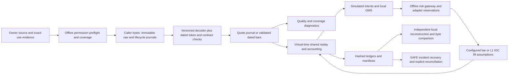

# G2 implementation and evidence inventory — 2026-11-08

## Admission continuation — 2026-11-09

The [offline admission sidecar](G2-ADMISSION.md) now joins permission decisions and exact input hashes, raw/normalized/mapping/calendar and decoder/schema/build resources, replay identity, feed re-audit and byte-bound cross-domain references. This completes a bounded production admission-report contract formerly available only as a test sidecar. Universal event semantics, normalized transformation verification, authoritative reference content and authenticated evidence remain partial or absent. CALLER_DECLARED admission always stays INCOMPLETE or FAIL. See the current [gap matrix](G2-ADMISSION-GAPS.md) and [validation report](../../research/systems/2026-11-09-g2-admission-validation.md). Historical counts below describe the prior increment; they do not validate this continuation. **Overall G2 remains INCOMPLETE.**

**Overall G2: INCOMPLETE.** This increment completes the demonstrated journal/recovery and test-runner fixes below. It does not complete every design capability or supply authorized real data. Software validation, source truth, rights, market correctness, profitability and live readiness are separate claims. Order egress remains absent and disabled.

Baseline: fresh `origin/main` `ff4874167e889a26990e1f4d9d2b1ffa4acbefe6`; public hosted [Actions 42438198778](https://github.com/Mscient/Intra/actions/runs/42438198778) completed successfully. The original `main` worktree at `2b7fe0a` had substantial tracked/untracked work and other worktrees; none was reset, stashed, cherry-picked or edited. Work is isolated on `codex/g2-offline-core-20261108`. The uncommitted external-ledger/holdout work in that older checkout is not treated as integrated code. Exact validation and publication status are recorded in the [validation report](../../research/systems/2026-11-08-g2-offline-validation.md).

G0/WP0 remains open on the inspected main: `G0-CHARTER-OPEN-ITEMS.md` and research `OWNER-INPUTS.md` have no signed current owner charter, actual budgets, applicable product grants, nominated authorized corpus or independent human approval. Older successful login/sample notes are observations, not rights. No market/account files, endpoints, credentials or private owner values were accessed in this increment. Research DR-01–11/13 remains candidate evidence; none of its 42 rows is promoted to a production registry.

Statuses below distinguish **IMPLEMENTED / scoped synthetic tests**, **PARTIAL / known design gap**, and **INCOMPLETE / external evidence absent**. A passing unit or CLI test is not a gate PASS. Existing tests are reused; no second book, strategy, order or risk implementation is introduced.

| Requirement | Existing code/contract | Tests / retained evidence | Gap and disposition |
| --- | --- | --- | --- |
| WP2 exact raw payload, source/connection/subscription and clocks | `RawMarketMessage`, `RawCapture*` v1 | New `G2ContractTest`: independently laid-out opaque golden bytes; defensive copies, limits, malformed identity | IMPLEMENTED for supplied bytes. Explicit capture/session/process-epoch fields are absent in v1; test-only frozen sidecar supplies them. General capture binding remains PARTIAL. |
| Connection/auth/subscription/heartbeat/reconnect | `FeedLifecycle*`, `FeedCaptureReconciler`, `InstrumentFeedCoverageAnalyzer` | Existing sequence/feed audit suites and new lifecycle resume tests | IMPLEMENTED local facts; explicit capture-start/end events and durable receive/write milestones absent. No feed connection. |
| Append-only, hashes, tail/crash, error handling and limits | Raw/quote/lifecycle writers use CREATE_NEW, lock, force, canonical chains | All raw truncation byte positions except valid empty header; corruption, failed import, damaged resume; gateway force/kill suites | Fixed Windows resume reading through its own locked channel; added raw 256 MiB cap and strict Unicode. Valid whole-row deletion/rechaining is not detectable without external trusted head. OS power loss remains untested. Quote/lifecycle have record caps, not a universal file cap. |
| Raw-to-normalized provenance and revisions | Canonical quote v1, saved NFO Snap decoder, raw importer; normalized bar raw-record hashes | Sequence/mapping/feed tests; process fixture includes raw/code/schema/revision identity | IMPLEMENTED scoped L1; decoder identity/changelog are not a mandatory universal importer sidecar. No v2 migration or repair of raw data. |
| Versioned quote/depth/trade/instrument/session/order/fill/config/risk schemas | Quote/raw/lifecycle binary v1, strict CSV headers, risk journal codec, strict feed/permission JSON | New invalid identity/quantity tests; existing malformed schema fixtures | PARTIAL: standalone normalized depth/trade schemas and one cross-domain event envelope are absent; some legacy manifests/CSVs lack explicit schema version. No invented feed semantics. |
| Timestamp/unit/identity/order/duplicate/boundary validation | `ValidatedDataset`, exact-time frames, dated mapping, quote quality, lifecycle and feed audit | Existing mapping/frame/feed suites now in selected CI; new +1ns stale/future and OMS tests | IMPLEMENTED within documented input schemas; source timestamp/sequence guarantees unresolved. Numeric gaps do not prove packet loss. |
| Per-dataset/run quality evidence | Dataset/run manifests, sessions, feed audit report, permission reports | New per-model `g2-synthetic-quality/v1` records bind exact input/run/journal hashes, date/zone/interval/roles, counts and unknowns | PARTIAL: test-only combined records; no universal admission/report joining every data class and real source contract. Real completeness INCOMPLETE. No interpolation or forward fill. |
| Dated instrument/token/contract/expiry/strike/right/lot/tick | `InstrumentMasterSnapshot`, `DatedInstrumentMappingRegistry` | Existing exact half-open date, overlap, mismatch and timezone checks | IMPLEMENTED supported fields. Full dated price bands, general multipliers and authoritative master provenance are not supplied by these registries. |
| Session/holiday/auction/pause/expiry/settlement/rule rows | `MarketRuleRegimeSchedule`, session calendar, feed activity schedule, settlement events | Portfolio, mapping, frame, settlement and feed suites | PARTIAL: basic regimes + explicit windows, no complete authoritative historical auction/pause/holiday chain. Registry hashes and IDs retained; not every full applied row is copied to each run. |
| Dated fees/taxes/bases; margin proxies | `ComponentCostSchedule`, execution/settlement schedules, `PortfolioRiskInputs` | Existing golden arithmetic, GST basis, date/overlap/blank/negative and settlement checks | IMPLEMENTED explicit supported charges. Tariff/invoice rounding, all-in completeness, clearing/impact/spread/capital/fixed costs need supported inputs/model and review. Unknown rates fail parsing/coverage or remain incomplete; not substituted with zero. Margin is a caller proxy, never SPAN/ELM. |
| WP3 virtual-time deterministic state | Bar and portfolio replay, integer quote ticks/whole lots, decimal accounting | New independent JVM UTC/en-US vs Pacific/Apia/tr-TR journal and three fill-view artifact comparisons | IMPLEMENTED exercised paths. Same JDK/build on Windows, separate JVMs/directories/settings; not separate OS/hardware or concurrent deterministic scheduling. Custom strategy determinism is a caller contract. |
| All eleven legal OMS states and remaining reservations | `OmsOrderStateMachine`, `ExecutionIdempotencyLedger`; simulator maps local aliases | New pending/unknown/replace paths, terminal resurrection, partial/full/overfill, conflicting IDs | IMPLEMENTED primitives; state-only terminal acknowledgements are caller facts. Replace rejection cannot terminate an already executed original order. No general asynchronous broker OMS. |
| Unknown/pending reserve worst case; idempotent executions | OMS remaining units; gateway working-order risk interval; adapter uncertainty freeze | New 150/50 remaining example; gateway and adapter suites | IMPLEMENTED scoped primitives/adapter. Caller must supply maximum old/new replace quantity and valid upper valuation bounds; generic OMS is not automatically joined to gateway. |
| Impossible ordering, unknown references and overfill | Gateway transactional events; `OmsRunRecovery` | Added hash-consistent negative artifacts: fill before creation/after terminal, timestamp disagreement, rejected fills, overfills; duplicates no-op | Fixed completed-run chronology and created/rejected quantity checks. Recovery rejects uncertainty; hashes alone are not semantic validation or authentication. |
| Cancels/reducing actions under entry halts | Gateway cancellation and bounded loss-halt closeout; adapter cancellation; simulator exit bypass | Existing gateway/adapter/loss fixtures and incident drills | IMPLEMENTED per documented simulator policy. Missing/invalid inputs still block new proposals; this does not certify a reachable broker cancellation path. |
| Journals/checkpoint/input/config identities and state hashes | Risk journal, adapter trace/checkpoint, replay checkpoint store | Existing durability/adapter/corrupt/lagging/kill tests | IMPLEMENTED local mechanics. No single universal event core journal; periodic state traces exist for adapter, not every independent core type. |
| SAFE restart, verify build/config/head, tail replay and reconciliation/release | Strict incident orchestrator SAFE_HALT; exact-head durable gateway; adapter checkpoint replay; completed-run recovery | Existing incident/recovery suites; new chronology/resume tests | PARTIAL: incident contract requires exact reconcile then authorized reset, but low-level `restore` APIs are diagnostic and do not impose universal SAFE release/build checks. Gateway exact head rejects lagging tails rather than accepting them. Trusted anchor/custody, generic tail replay and independent external reconciliation remain open. Never adopt a damaged head. |
| WP4 position/notional/margin/rate/loss/session controls | `RiskGateway`, single-contract `RiskGate`, portfolio adapter/audit | Gateway 447 checks, process harness, portfolio risk/audit and drills (historical counts; current results in report) | IMPLEMENTED explicit supported controls. Gateway daily P&L is gross of fees; net loss/rate semantics differ by component. No implicit private threshold or real budget. |
| Independent recomputation | Risk state derives from accepted/execution/cancel events; risk audit reconstructs replay | Existing accounting/risk/audit/settlement fixtures | IMPLEMENTED independent local reconstruction; same trust domain/process for adapter. External/account independence INCOMPLETE. Uncommitted external-ledger work excluded. |
| Missing/stale/future/uncertain/limit/journal/recovery failures | Adapter freeze, gateway input validation/durability, feed policies, incident state | Existing breaker/force/kill/input and new stale/future/tail checks | IMPLEMENTED scoped fail-closed behavior; direct diagnostic helpers can bypass orchestrator and cannot authorize use. |
| Latched halt and recovery | Daily loss latch, adapter uncertainty, incident SAFE_HALT | Existing explicit reconcile/reset and mismatch fixtures | IMPLEMENTED simulated transitions; no authenticated operator release or external kill path. |
| K0–K3 and metrics/alerts | `OperationalKillController`, feed reports, daily evidence, incident reports | Existing policy suite now in CI; existing daily/incident checks | PARTIAL: recommendation state machine, not watchdog/kill switch. Feed age/count/gaps, order/fill/position/P&L/proxy/halt observations supported; runtime journal lag/queue/API latency/standby measurements unknown without lawful telemetry. |
| WP5 shared simulator full/partial/missed/cancel/reject/stale/boundaries | `BacktestEngine`, `QuoteExecutionBook`, portfolio replay/lifecycle/accounting, explicit fill model | Existing portfolio engine/cost/settlement/risk tests; new L1 stale/future/partial/miss checks and three CLI process views | IMPLEMENTED tested assumptions. BAR_NEXT_OPEN, L1_FULL_SIZE_IOC and L1_PARTIAL_IOC are labeled diagnostic scenarios. Snapshot consumption is no queue/L3/passive/capacity proof; latency is supplied, not measured. |
| Markouts/cost/capital/net separation | Bar signal ledger, fill prices/slippage, fee lines, equity, settlement lines | Existing arithmetic/reconciliation | PARTIAL: signal index markouts are not executable P&L; no complete realized-spread/impact/capital-charge attribution model. No uncalibrated “central” result. |
| Immutable provenance and deterministic reconstruction | Single/portfolio artifact writers/verifiers, dataset/build/config/cost/reference hashes | New 42 complete artifact files + normalized journal + three quality records compared; existing portfolio reconstruction | IMPLEMENTED supported outputs, not authenticity/signatures. Legacy single verifier hashes outputs; replay-verify reconstructs. Build-Commit validation required for clean packaged revision. |
| Rights/authenticity/reviewer/real-data/operations | Existing permission preflight/coverage, DR research, daily evidence | Synthetic permission positive/negative suites and source/use map | INCOMPLETE independently in every real-data dimension. No real corpus nominated, opened or substituted. G0/G2/G4/G5 remain open. |

## Architecture and trust boundaries

All arrows are local function/file operations. The permission checker is an explicit caller gate, not an interception layer for all CLI commands. Until exact source/use evidence exists, only synthetic authoring and specifically authorized caller bytes may enter. Do not open even a local real dataset merely to compute its hash before authorization to inspect it. Read-only import helpers do not create a broker adapter. There is no network client, broker credential loading, account connection, order submission, external watchdog, account reconciliation or kill action in this architecture.

Trust boundary 1: owner/reviewer declarations and source documents remain unauthenticated; public/SDK/schema availability is insufficient. Boundary 2: raw chains identify retained bytes, not omitted receives, issuer identity or source sequence guarantees. Boundary 3: normalized projections and dated source references are versioned caller assumptions, not exchange certification. Boundary 4: simulator outcomes and risk state derive from those assumptions; metrics must retain OBSERVED/CALLER_SUPPLIED/SIMULATED/UNKNOWN classification. Boundary 5: external checkpoint heads, build identity and reconciliation require protected custody and reviewer/operator release; recomputing a damaged head supplies no new trust.

## Event contracts and changes

Raw v1 keeps exact opaque payload bytes, optional supplied counter, receive Instant and same-domain monotonic value. Upstream time stays inside payload until a named decoder interprets it; no upstream time or counter is invented. Quote v1 uses integer ticks/units, optional exchange Instant, local normalized sequence and receipt clocks. Lifecycle v1 uses a fixed control vocabulary and sanitized identity text. Configuration/contract/session/cost CSVs retain their documented inclusive versus exclusive date conventions; never copy an endpoint date without conversion. Risk journal events have explicit application Instants and event IDs. OMS execution IDs bind order/time/side/units/price; repeated identical IDs are idempotent, conflicting reuse fails closed.

This increment preserves every existing v1 byte encoding for valid text. Raw, quote and lifecycle identities now reject controls, unpaired surrogates and more than 65,536 UTF-8 bytes before lossy encoding can occur. Raw payload limit is 1 MiB; encoded record limit remains 1 MiB + 65,536; raw journal cap is 256 MiB. Rotate to a new explicitly declared part before exhaustion. Existing larger raw files now reject; no truncation/migration/repair is performed. Full journal verification on resume runs through the locked channel, retaining ownership throughout verification and append. Consumers of streaming readers must discard any prefix on later failure.

Completed-run OMS recovery additionally validates decision/submission/fill and CREATED/final-event chronology, unique execution order, and invalid created/rejected filled quantities. A replace rejection is a rejection of an amendment; it must preserve the original order's uncertainty/executions instead of setting its full order state to REJECTED. Existing simulation acknowledgements remain immediate local facts. Full asynchronous OMS/replace semantics require a separately reviewed supported event contract.

## Open decisions and readiness

| Dimension | Status | Required evidence |
| --- | --- | --- |
| Code | PARTIAL | Scoped fixes implemented; remaining generic schemas, capture identity, dated bands/phases, full quality admission and universal SAFE/build/head/release path above. |
| Synthetic validation | PASS / SYNTHETIC_OFFLINE_ONLY | All 18 selected suites and packaged/drill checks passed at 819a53c1; 365 G2 assertions in source/JAR modes, 42 artifacts + journal + three quality records byte-identical. Synthetic success is not G2 closure. |
| Authorized real data | INCOMPLETE | Exact nominated contracts/dates/products/files; all source/use clauses and before-use checks. |
| Source authenticity and market correctness | INCOMPLETE | Original issuer/version/amendment evidence, independently verified timestamps/fields, contract/session/cost rows and corpus completeness. |
| Independent review | INCOMPLETE | Named human/source-rights/risk/recovery/fill reviewers and accepted promotion records. AI synthesis is not approval. |
| Operational readiness | INCOMPLETE | Owner limits/authority, trusted anchors, independent reconciliation, measured telemetry and tested intended-environment recovery; G4 session campaign absent. |

Owner O01–O14 in the research pack remain open, including actual scope/route/budget, rights/retention/backups/derived outputs, clock/gap/sequence semantics, current tariff/invoice/settlement and margin proxy/model sources, fill tier and lawful calibration, reviewer and release authority, trusted storage/RPO/RTO and manual path. Source-version/CAS/pre-open/current-rule conflicts are not resolved by this code. No strategy tuning, holdout inspection or DSR/PBO/HAC changes occurred. This increment cannot authorize live trading.

See the [source/use evidence map](G2-SOURCE-USE-EVIDENCE.csv), [operating guide](OPERATING-GUIDE.md), [permission contracts](DATASET-INTENDED-USE-PREFLIGHT.md), [coverage checker](DATA-PERMISSION-COVERAGE.md), [feed audit](FEED-COMPLETENESS-GAP-AUDIT.md), and current [source research pack](../../research/systems/g2-source-research-2026-11-05/README.md).
