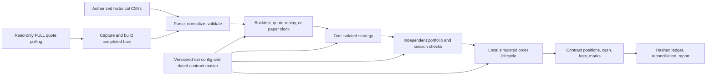

# Nifty Intraday Trading System — Final Design

- **Status:** Final architecture and strategy-portfolio design for the research/paper release. Data qualification and strategy validation remain open.
- **Version:** 1.0
- **Reviewed:** 2026-11-02 (Asia/Kolkata)
- **Market/broker scope:** NSE Nifty instruments; Angel One SmartAPI for read-only market data.
- **System scope:** S01–S10 research systems and their isolated backtest/paper workflow.

## 1. Purpose

This is the consolidated design for the Nifty intraday system. It completes the system-level architecture and defines all ten strategy or execution candidates tracked in [SYSTEM_TRACKER.md](SYSTEM_TRACKER.md). The [ten-system research review](TOP-10-TRADING-SYSTEMS.md) remains the evidence review, and the [Wave A signal specification](WAVE-A-SIGNAL-SPEC.md) remains the exact signal rulebook for S01–S03. The [paper-system roadmap](PAPER-TRADING-BACKTESTING-ROADMAP.md) remains the build and delivery schedule.

“HFT” is the project label. The current design is a Python research and paper system using retail data access. It is not an exchange-colocated, sub-millisecond trading platform. It does not route live orders. The system cannot claim strategy profitability or execution quality until the corresponding dated contract data, cost assumptions, fill model, and validation gates pass.

## 2. Objectives and boundaries

### Objectives

- Give each candidate system an isolated rule, input set, run record, evaluation method, and readiness state.
- Keep the data-to-decision-to-risk-to-simulated-fill path reproducible and auditable.
- Reuse one paper simulation core for historical replay and read-only live-data paper sessions.
- Distinguish signal markouts from contract P&L and execution results.
- Stop a system at its data gate when its required fields or history are unavailable.

### Repository and runtime boundaries

| Area | Responsibility | Boundary |
|---|---|---|
| HFT 2 research repository | Design documents, source reviews, trackers, and reviewed non-executable summaries | No broker credentials, raw restricted market data, experiment code, or order routing |
| `Intra-Systems-Lab` | Isolated strategy experiments, one run space per system, frozen local inputs, run manifests and outputs | Separate environment; network disabled during replay; no broker SDK, secrets, application database, or order route |
| `Intra-Paper-System` | Shared local backtest and live-data paper simulator | Read-only market data only; simulated orders and portfolio only; no broker place/modify/cancel methods |
| Angel One SmartAPI | Read-only market-data source for this release | Authentication and market-data calls do not authorize or imply live order routing |

The lab-to-document flow is one-way: frozen authorized inputs enter an isolated run, and only reviewed summaries and manifest identifiers return to HFT 2. The paper simulator and research lab remain separate products; reviewed strategy rules and data manifests can be shared, but raw licensed data, run state, secrets, and experiment code do not move into HFT 2.

### Operating modes

| Mode | Source | Clock | Result |
|---|---|---|---|
| Historical backtest | Frozen local CSV input | Deterministic event/bar replay | Simulated decisions, orders, fills, portfolio and report |
| Saved-quote replay | Frozen local quote capture | Recorded event/receive order | Same simulator and accounting as backtest |
| Live-data paper | Read-only SmartAPI FULL quotes; completed one-minute bars built locally | Paper clock with local receive-time tracking | Local simulated portfolio; no broker orders |

The documented first-release implementation is CSV-only. It uses a Python CLI, dated contract records, data-quality checks, deterministic replay, a local order lifecycle, futures/options accounting, configured fees and risk limits, quote-to-minute-bar construction, a read-only SmartAPI adapter, and hashed manifests/reports. The separate system repository records 18 engine tests passing and read-only quote/authentication smoke checks; these were not rerun as part of this document update.

## 3. End-to-end system flow

Every intent passes through the same pipeline:

1. **Observe:** read only valid, timestamped data and the effective-dated contract master.
2. **Decide:** emit a signal or a no-trade reason using information available at that time.
3. **Control:** risk checks allow, resize, or reject the intent independently of the strategy.
4. **Simulate:** create local order IDs and apply the selected fill/cancel/reject rules.
5. **Account:** update contract positions, cash, fees, exposure, realized and unrealized P&L.
6. **Reconcile:** link each result to the input events, config, model versions, and run manifest.

Strategy code cannot call the broker adapter or simulator directly. The adapter cannot create orders. The risk engine is the only path from intent to simulated order.

## 4. Shared subsystem design

### 4.1 Data and contract identity

The system accepts dated instruments, OHLCV bars, quote snapshots, and strategy intents through versioned CSV schemas. Each run records input paths outside Git, file hashes, source, retrieval/capture time, timezone, schema version, and the relevant instrument-master snapshot.

Each actual futures or options contract has an internal ID plus its dated symbol/token mapping, underlying, expiry, strike and option type where applicable, lot size, and tick size. Daily SmartAPI master imports are point-in-time snapshots, not a historical contract master. Unknown or ambiguous mappings, missing contract metadata, and incomplete sessions block affected trades and invalidate affected scoring. The index is signal context only; it is not a derivative fill price.

The documented checks cover duplicate and missing bars, timestamp roles, interval consistency, regular-session bounds, contract effectiveness, quote freshness, and order/risk validity. The current implementation has no exchange holiday calendar, so it does not detect full missing trading days. It must not forward-fill missing prices or infer a session calendar from weekdays.

### 4.2 Time, replay, and look-ahead control

Exchange event timestamps, local receive timestamps, and bar labels are distinct fields. Persist the source timestamp and local receive time; do not silently reinterpret one as the other. The event engine processes only completed information. Late or out-of-order events are flagged and are not applied retroactively to earlier strategy decisions.

A signal on a completed bar is known at that bar's close. Bar-based simulated entry is no earlier than the next eligible bar under the configured fill rule. For quote mode, record the quote age and use the applicable opposing side for a marketable simulation. Each run records time zone, interval, event ordering, timestamp role, data warnings, and the exact data/config hashes.

### 4.3 Strategy modules and isolation

Each strategy has a unique system ID, rule version, config, input manifest, run directory, and result set. Strategy modules return a signed intent or a no-trade reason; they do not own risk, position accounting, data access, or fill assumptions. The lab plan forbids cross-reading of another system's signals, fitted parameters, or results.

S01–S03 have fixed signal-only baselines on NIFTY 50 one-minute bars. S04–S10 remain separate research designs with their own data gates. An execution method such as VWAP/TWAP is evaluated against a fixed parent order and is not counted as directional alpha.

### 4.4 Risk, margin, and session controls

Before simulated submission, the independent risk layer checks instrument allowlist, contract validity, session, stale/missing data, order size, lot multiples, notional and gross exposure, open positions/orders, order rate, daily loss, short-position policy, expiry restrictions, and available configured margin. It records each decision and reason.

Limits and example fees in the current implementation are placeholders until reviewed and dated. Configurable approximate futures and short-option margin and maintenance liquidation are implemented, but they are not exchange SPAN/ELM requirements. Missing or unreviewed values prevent economic interpretation. A risk breach, stale feed, unknown contract, session cutoff, or ledger fault blocks new simulated entries.

### 4.5 Orders, fills, and accounting

The local order lifecycle records accepted, partially filled, filled, canceled, expired, and rejected states with local IDs and timestamps. A local cancel action is a simulator transition; it is not a broker cancel API call.

Fill rules are explicit and versioned:

- Bar-only signal: earliest fill is the next eligible bar; never fill at the same close that generated the signal.
- Quote-based marketable simulation: use the available opposing top-of-book price, record quote age/size, and apply declared latency and slippage.
- Passive limit order: a candle touching a limit does not establish a fill. Without order-event and queue-position data, report a conservative no-fill case or a clearly labeled queue sensitivity; do not present a snapshot-depth touch as a primary result.
- Partial fills, expiry handling, slippage, and rejections are configuration/model assumptions, not hidden inside strategy logic.

The ledger separates futures variation P&L from options premium cash flows and reports gross/net P&L, fee components, exposure, turnover, drawdown, realized/unrealized values, fill rates, and reconciliation warnings. Options P&L is contract-premium based, not an underlying-index mark. Expiry settlement uses dated settlement input or a clearly flagged complete-session final-bar proxy. Partial expiry data without settlement remain open; physical delivery is outside the current release.

### 4.6 Paper-data adapter and operations

The paper adapter uses read-only historical-candle and FULL-quote endpoints; the documented implementation polls snapshots and builds completed one-minute bars. It records local receive time and rate-limit, disconnect, stale, out-of-order, malformed, and unknown-contract events. On a gap or disconnect it blocks new entries until valid data resume and pass freshness checks. Reconnection does not repair missing intervals.

No live order methods, routes, IDs, or fallback behavior are present in the paper adapter. Secrets remain in a local secret store or ignored environment file and must not appear in Git, test fixtures, manifests, or logs. Raw private data and run outputs remain outside the documentation repository unless terms permit otherwise.

## 5. Strategy and execution system designs

System cards below define the role, decision model, execution boundary, and data gate for all ten tracked candidates. Exact S01–S03 signal rules refer to the frozen formulas in the Wave A specification. For systems whose thresholds or universe are not frozen, development-only choices must be recorded before validation/holdout; do not select a winner after inspecting holdout results.

### S01 — Opening-range breakout

- **Role/hypothesis:** test whether a confirmed break of the opening range predicts near-term continuation.
- **Signal baseline:** calculate the high/low of the first 15 complete one-minute regular-session bars. From the next bar onward, emit one signal on the first close strictly above/below the range. At most one signal per session. Score the fixed 15-minute index return; 5- and 30-minute returns are secondary diagnostics.
- **Execution design:** current Wave A is index-signal-only. A later trade test requires a dated Nifty futures contract, a predeclared entry rule, stop/invalidation, last-entry time, exit rule, and cost/fill model. Do not infer fills from index marks.
- **Readiness:** signal runner implemented and smoke-tested on a partial 2 Nov 2026 session; not strategy-validated. Full-session data and the closing-period gap review remain open.

### S02 — Intraday time-series momentum

- **Role/hypothesis:** test whether the recent direction of NIFTY predicts the next fixed short-horizon return.
- **Signal baseline:** after the first 30 complete session minutes, at each 15-minute decision point compute `log(close_now / close_30_minutes_ago)`. Emit long for a positive value, short for a negative value, and no signal for zero or missing input. Keep the lookback and cadence fixed; no volatility threshold or post-result horizon selection.
- **Execution design:** Wave A records directional index signals. A futures test needs dated futures prices and a separately frozen position, exit, and order policy. The signal bar close is never the fill.
- **Readiness:** runner implemented and partial-session smoke-tested; not strategy-validated. Full-session data and timestamp semantics remain open.

### S03 — Opening gap reversal

- **Role/hypothesis:** test whether a first-15-minute move opposite the overnight gap continues in the opening-move direction.
- **Signal baseline:** calculate the log gap from prior regular-session close to session open. Calculate the first 15-minute log move from open. If both values are nonzero and have opposite signs, emit one signal in the opening-move direction at the block close; otherwise emit none. Require a verified prior-session close. Compare with gap continuation and no-signal baselines.
- **Execution design:** current output is signal-only. A futures system needs a fixed stop/invalidation, entry cutoff, exit, and realistic costs before contract P&L can be reported.
- **Readiness:** implementation exists; a verified prior close is required for a valid run. No strategy validation has occurred.

### S04 — VWAP-deviation mean reversion

- **Role/hypothesis:** test whether an unusually large deviation from session VWAP tends to converge, conditional on regime.
- **Signal design:** compute VWAP from actual traded volume and price for the dated contract. Define a volatility-normalized deviation and a trend/regime gate on development data only; freeze the threshold, regime gate, entry, target, and time stop before validation. Compare the frozen gate with the same deviation rule without the regime gate. Never calculate VWAP from NIFTY index candles, whose volume is zero.
- **Execution design:** trade only the same dated, volume-bearing contract used to calculate VWAP. Use executable quote/next-bar assumptions and cost sensitivity; report convergence time and adverse excursion.
- **Readiness:** hypothesis reviewed; no direct Nifty evidence. Not testable on index bars. Needs adequate dated futures volume history; SmartAPI-only multi-expiry history is not established.

### S05 — Nifty spot-futures lead-lag and basis

- **Role/hypothesis:** test either predictive lead-lag or executable basis convergence, as two separately reported questions.
- **Signal design:** synchronize an index/spot proxy with an actual dated futures contract. Predeclare a fair-basis model using expiry/time-to-expiry and carry inputs. Define signal thresholds from training data only. Report lead-lag predictability separately from paired arbitrage P&L; a price lead is not an arbitrage.
- **Execution design:** model both legs, both spreads/fees, partial fills, legging exposure, basis widening, and time/expiry exits. Do not score arbitrage P&L unless both legs have executable data and fills.
- **Readiness:** research review prepared. Synchronized historical quotes and expired futures contracts are missing or unverified; long-period paired P&L is deferred.

### S06 — VWAP/TWAP execution

- **Role/hypothesis:** compare execution schedules for the same parent order; this is an execution system, not a standalone directional signal.
- **Signal/parent input:** define a fixed parent side, size, decision time/price, and deadline independently of the schedule. Compare an immediate baseline, a fixed TWAP schedule, and a predeclared VWAP schedule based on a historical volume profile. Keep parent orders identical across methods.
- **Execution design:** local simulator only. Track child order lifecycle, residual quantity, partial fills, and cancellations. Use actual quote/order events where available; do not send through SmartAPI.
- **Readiness:** execution literature reviewed; no verified sandbox and no historical quote archive. Remains offline until parent-order examples and prospective quote data are ready. Report implementation shortfall, completion, residual quantity, adverse movement, and fees separately from signal results.

### S07 — Pairs / relative-value trading

- **Role/hypothesis:** test convergence of a preselected two-instrument spread while controlling hedge and legging risk.
- **Signal design:** select a pair and hedge ratio on training data only. Freeze spread construction, entry/exit, relationship-break rule, and rebalance policy before validation. Do not select pairs using the final holdout.
- **Execution design:** model each leg independently, including the state where only one leg fills, temporary unhedged exposure, emergency hedge/exit rules, both-leg costs, and hedge-ratio drift.
- **Readiness:** public-source review prepared. No pair, synchronized two-leg history, or joint-fill evidence is selected; defer until these inputs are chosen and licensed.

### S08 — Order-flow imbalance

- **Role/hypothesis:** test whether signed changes in best bid/ask queues and trades predict a declared short-horizon mid-price move.
- **Signal design:** use timestamped quote and trade events to calculate event-level imbalance. Five-level periodic snapshots may support only a separately labeled snapshot proxy; they cannot reconstruct arrivals, cancellations, or queue changes between polls. Set event horizon, freshness filter, and baseline before testing.
- **Execution design:** include spread, available depth, receive latency, stale/missing rates, and slippage. Compare against a mid-price baseline first; any predictive relation must still survive executable net costs.
- **Readiness:** not tested on Nifty. Prospective five-level quote capture may establish data readiness only. No historical event archive or index sequence numbers are available in the documented SmartAPI feed.

### S09 — Limit-order market making

- **Role/hypothesis:** test passive bid/ask quoting while controlling inventory and adverse selection.
- **Signal/quote design:** define fair value, quote offsets/sizes, inventory skew, inventory cap, and cancel/replace policy. Use a local event-driven simulator with separate queue-model sensitivities; never assume every displayed quote would fill.
- **Execution design:** require order-book and trade events, queue priority/fill estimates, cancel/replace latency, fees, and inventory controls. Measure post-fill markouts, adverse selection, spread capture, cancellations, and worst inventory drawdown.
- **Readiness:** model review prepared, but not testable with documented SmartAPI five-level snapshots alone. Defer until event-level history and a defensible queue/fill model exist.

### S10 — Delta-hedged options volatility

- **Role/hypothesis:** test whether a frozen implied-versus-forecast-realized volatility rule can earn net value after hedging and option costs.
- **Signal/design inputs:** require synchronized dated option and underlying-futures quotes, contract metadata, an implied-volatility surface, realized-volatility forecast, Greeks, and an explicit volatility position (for example, a defined straddle) with hedge trigger and expiry policy. Freeze forecasts and hedge rules before validation.
- **Execution design:** simulate option and futures legs at executable bid/ask prices, include re-hedging, spread/slippage, expiry/settlement, jumps, and Greeks-based P&L attribution. Mid-price-only option fills are not acceptable.
- **Readiness:** public-source review prepared; no Nifty strategy validation. Expired option history, historical surface, and fills are absent/unverified. Defer until licensed historical data or multi-expiry prospective capture and settlement rules are available.

## 6. Evaluation design and promotion states

### Common experiment record

Every isolated run records system ID, lab commit, dataset ID/hash, instrument/contract definitions, timezone, interval, run dates, rule/config version, cost/fill model, random seed where used, benchmark, metrics, output hashes, and a decision state. Save the signal stream separately from simulated order/fill and portfolio ledgers.

### Shared scoring rules

- Prefer executable timestamped bid/ask and order events. Where only bars exist, use a predeclared conservative next-bar rule and call it a bar-data approximation.
- Include brokerage, exchange/statutory charges, spread, slippage, partial fills, non-fills, and dated fee schedules.
- Use chronological development/validation/holdout periods. Freeze rules, thresholds, baselines, variants, and costs before opening the holdout. Use purging/gaps when labels or positions overlap splits.
- Report gross/net expectancy, drawdown, tail loss, turnover, exposure, fill/completion ratios, shortfall, cancellations/rejections, and time-of-day/regime breakdowns.
- If a critical input is absent, stop and record `not testable with current data`; do not invent it or use index prices as executable derivatives P&L.

For S01–S03 the Wave A specification additionally fixes the primary 15-minute directional index markout, chronological 60/20/20 split, session-level inference, stationary bootstrap, and adjusted validation/holdout decision rules. These are signal-evidence gates only. Even a statistical pass requires a separate dated futures study with costs, quotes, risk, and a declared fill model before any economic claim.

### Per-system states

Use exactly one state per system at each review:

- `not testable with current data` — a required input, coverage, timestamp, or license gate fails;
- `rejected under predeclared criteria` — frozen decision rule rejects the candidate;
- `requires better data/model` — model or execution evidence is insufficient;
- `candidate for another isolated simulation` — evidence supports another isolated step, not live deployment;
- `not yet evaluated` — no qualifying evaluation exists.

Passing a data or software gate does not imply a strategy pass. A paper session does not prove profitability.

## 7. Failure handling and safety behavior

| Condition | Required response |
|---|---|
| Stale/disconnected feed, subscription loss, or a data gap | Record event, block new simulated entries, and resume only after valid fresh data return |
| Malformed, duplicate, or out-of-order data | Preserve diagnostic/quarantine record; do not repair silently or backfill past decisions |
| Unknown or invalid contract | Reject intent and mark affected interval/result unscorable |
| API rate limit or request failure | Respect documented/conservative rate policy, record the failure, block entries until health returns |
| Session/timestamp inconsistency | Stop scoring; require data review before reuse |
| Disk/ledger failure or simulator invariant failure | Stop the run immediately; do not continue from partial or double-counted state |
| Process restart | Start a new run ID and reconcile prior simulated open orders/positions; never assume seamless continuity |
| Risk breach or operator stop | Block new entries, persist reason/state, and follow configured paper-only exit behavior |

There is no fallback to a broker order route under any failure condition.

## 8. Current implementation limits and open gates

The separate paper-system roadmap records the following implementation and readiness boundaries as of 2026-11-02:

- CSV-only storage; no exchange holiday calendar, exact SPAN/ELM margin, physical delivery, queue model, or full-depth simulation.
- Margin is configurable and approximate, not an exchange requirement. Example fees/risk values still need reviewed dated schedules.
- Daily instrument-master import is effective from its snapshot date; it is not a historical contract master.
- Expiry settlement needs supplied dated settlement prices or a flagged complete-session final-bar proxy. Partial expiry data without settlement remain open.
- SmartAPI expired-contract history, lawful local retention, and multi-expiry futures/options coverage remain unconfirmed or unavailable; current-contract-only data cannot support an unbiased multi-expiry result.
- The 30 Oct 2026 NIFTY index candle sample has a reproduced closing-period timestamp gap; the full 2 Nov session refresh/review is pending in the recorded baseline.
- No strategy has passed validation, no qualifying market-derived result is reported, and no live orders have been submitted.

Before performance scoring: close the timestamp/session data review; confirm data permissions and expired-contract coverage; choose a licensed history source or prospective capture plan; replace placeholder fees/risk/margin assumptions; verify dated option expiry handling; and run deterministic replay on frozen authorized inputs.

## 9. Delivery gates

1. **Isolation:** separate lab, environment, inputs, outputs, and no order route are reviewed.
2. **Data:** source terms, timestamps, session coverage, contract mappings, missingness, and hashes pass for the specific system.
3. **Rules:** signal, parent order where applicable, exits, costs, fills, variants, benchmark, and thresholds are frozen before validation.
4. **Replay:** identical frozen inputs, code, rules, and seed reproduce the same decisions, orders, fills, and ledger.
5. **Risk/accounting:** limits, fees, contract multipliers, partial fills, margin assumptions, expiry behavior, and reconciliation are reviewed.
6. **Paper operations:** complete sessions are captured and reconciled; disconnect/stale-data behavior is visible. This is operational evidence only.
7. **Strategy evidence:** adequate dated data, chronological holdout, realistic costs, fill sensitivity, and independent review support a separately stated outcome.

The 90-day target is an operational local paper/backtest system. It does not guarantee that every candidate becomes testable or profitable. S04–S10 proceed only when their individual input gates pass.

## 10. System portfolio status

| ID | Design status | Current next gate |
|---|---|---|
| S01 | Fixed signal design; offline runner exists | Complete-session data review; later dated futures execution study |
| S02 | Fixed signal design; offline runner exists | Complete-session data review; later dated futures execution study |
| S03 | Fixed signal design; offline runner exists | Verified prior close and complete-session run |
| S04 | Design and data gate defined | Dated traded volume/futures history; predeclare parameters |
| S05 | Design and paired-leg evaluation defined | Synchronized spot/futures data and both-leg execution evidence |
| S06 | Execution-only design defined | Parent-order inputs and authorized quote/event capture |
| S07 | Two-leg relative-value design defined | Select a pair on training data and obtain synchronized two-leg history |
| S08 | Event-level OFI design defined | Prospective or licensed event-level quote/trade history |
| S09 | Market-making design defined | Order-level/queue-quality history and fill simulator |
| S10 | Options-volatility design defined | Dated options surface, futures hedge data, expiry rules, and costs |

All systems remain research/paper candidates. The current system design is complete at the architecture and evaluation-contract level; missing data, model parameters, and validation outcomes remain explicit gates rather than assumed results.

## References

- [Trading system research tracker](SYSTEM_TRACKER.md)
- [Ten-system research review](TOP-10-TRADING-SYSTEMS.md)
- [Wave A signal specification](WAVE-A-SIGNAL-SPEC.md)
- [Isolated testing plan](ISOLATED-TESTING-PLAN.md)
- [Instrument/data capability matrix](INSTRUMENT-DATA-CAPABILITY-MATRIX.md)
- [Paper-system implementation roadmap](PAPER-TRADING-BACKTESTING-ROADMAP.md)
- [Angel One SmartAPI market-data documentation](https://smartapi.angelone.in/docs/MarketData)
- [NSE Data Sharing and Usage Policy](https://www.nseindia.com/static/market-data/nse-data-policy)
