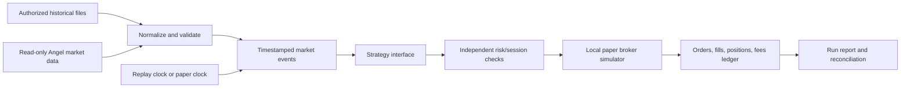

# Nifty Futures and Options Paper System — Build Roadmap

- **Status:** Offline backtesting core now includes configurable approximate margin, maintenance liquidation, and expiry cash settlement support; 18 tests pass, including synthetic CLI and engine-level accounting checks. Broker access and market-data runs have not been performed.
- **Reviewed:** 2026-11-02 (Asia/Kolkata).
- **User-selected broker:** Angel One SmartAPI.
- **User-selected instruments:** Nifty index futures and Nifty index options.
- **Target:** A local, cost-aware backtest and paper simulator within the project's 90-day target. Strategy validation depends on data gates and is a separate outcome.

## 1. Existing baseline

The HFT 2 repository is a research and planning record. Experiment code belongs in the separate `Intra-Systems-Lab`; do not add SmartAPI credentials, account connectivity, broker order routing, or experiment code to HFT 2.

The Wave A offline lab already has fixed S01-S03 signal definitions and a runner for NIFTY 50 index candles. The latest recorded smoke input covers only part of the 2026-11-02 session; a completed-session refresh is scheduled for later today. The 2026-10-30 SmartAPI sample also has a reproduced closing-period timestamp gap. Those index results are signal markouts only, not contract P&L, trade fills, or evidence of a profitable strategy. See the [Wave A plan](SAME-DAY-MVP-BUILD-PLAN.md), [signal specification](WAVE-A-SIGNAL-SPEC.md), and [instrument/data matrix](INSTRUMENT-DATA-CAPABILITY-MATRIX.md).

**System boundary:** the separate local `Intra-Paper-System` project holds the paper/backtest product. It shares one simulation core between historical replay and paper mode. Keep the existing `Intra-Systems-Lab` offline and strategy-isolated; exchange only reviewed specifications, data manifests, and result summaries. HFT 2 remains documentation and review only.

**Implementation status (2026-11-02):** local commits `c568543`, `3cde788`, `e86a465`, `5ef40d9`, and `f3e8d27` establish the Python CLI, CSV templates/loaders, dated-contract model, quality gate, deterministic replay, signal-file and unvalidated SMA/no-op strategies, futures/options accounting, risk/session checks, fee configuration, local order lifecycle and cancellation, quote-to-minute-bar builder, read-only SmartAPI market-data adapter, hashed reports, and synthetic CLI smoke. The offline engine adds dated expiry settlement inputs, complete-session close proxies, configurable approximate futures/short-option margin, initial-margin order rejection, maintenance-margin forced liquidation, and run-manifest settlement hashes. All 18 standard-library tests pass; this is plumbing/accounting evidence only. No SmartAPI credentials or market-data requests were used, and no strategy result has been generated. Instrument metadata, datasets, and verified fee/margin schedules still need authorized sourcing.

Current release limits: CSV only; no automatic contract-master importer, exchange holiday calendar, exact exchange SPAN/ELM margin, physical delivery, queue model, or full depth simulation. Margin rates are configurable approximations, not exchange requirements. Expiry uses supplied dated settlement prices or a clearly flagged complete-session final-bar proxy; partial expiry data without settlement remain open. The fee and risk values in the example config are placeholders. Expired-contract coverage and lawful historical data remain unresolved gates.

## 2. Scope and operating modes

The MVP has two modes that use the same strategy interface, contract model, risk checks, fee model, and paper fill simulator:

1. **Historical replay:** read a frozen, locally staged dataset and advance a deterministic event clock. Each run records its code version, rule/config version, dataset and instrument-master hashes, cost-model version, and run ID.
2. **Live-data paper mode:** poll read-only FULL market-data snapshots, record local receive time, build completed one-minute bars, generate simulated order intents, and update only the local paper portfolio. No method or fallback sends an order to Angel One.

The market-data adapter and the simulated broker must be separate modules. Keep credentials in the user's local secret store and outside Git, logs, test fixtures, and run manifests. The paper runtime may connect to market-data endpoints only. Do not include or call SmartAPI place, modify, or cancel order endpoints. The system should stop creating new simulated entries when data are stale, disconnected, malformed, outside the configured session, or mapped to an unknown contract.

## 3. Instrument sequencing and data gates

Both futures and options are in scope. Build futures first because options require more contract, chain, expiry, and quote handling. Keep both goals explicit; passing the futures data gate does not imply the options gate has passed.

| Instrument | First use | Data gate | Known limitation |
|---|---|---|---|
| NIFTY 50 index | Signal research and benchmark only | Resolve timestamp semantics, full-session coverage, and the reproduced 30 Oct closing gap | Index volume is zero; index marks cannot be scored as executable futures/options P&L |
| Dated Nifty futures | First executable-contract backtest and paper simulator | Obtain dated contract prices, dated instrument metadata, and a defensible fill/cost model | The current capability matrix reports that SmartAPI does not provide expired F&O history; confirm with Angel One. Current-contract data alone cannot support a multi-expiry historical result |
| Nifty options | Contract-level premium backtest and paper simulator after futures plumbing | Obtain dated contract OHLC/quotes for selected strikes and expiries, plus expiry-aware contract metadata and settlement rules | SmartAPI's expired-contract history is reported unavailable, and historical Greeks/surface coverage is unverified. A backtest based only on current contracts is survivorship/selection biased |

For derivatives, preserve every actual contract and expiry. Never treat NIFTY index bars or a continuous futures chart as a fillable contract. Store dated instrument-master snapshots, including token, trading symbol, expiry, strike, option type, lot size, and tick size. Record the source terms, collection time, timezone, raw-file hash, and any corrections.

Before a multi-expiry backtest, select one of these lawful data paths: an archive whose license permits the intended local use, or prospective capture that spans the needed futures/options expiries. No-cost SmartAPI endpoints do not remove data-retention, history-depth, or completeness limits. If only prospective capture is available, report that the historical validation sample is not yet available; do not fill old expiries with current contracts or synthetic data.

## 4. Proposed system architecture

Start as one local process with a command-line interface and saved reports. The core modules should cover:

- **Market data:** CSV/Parquet import, SmartAPI read-only history/stream adapter, dated instrument master, exchange calendar, and provenance/data-quality checks.
- **Event engine:** deterministic replay and live paper clocks; normalize completed bars, quote snapshots, and disconnect/stale-data events.
- **Strategy interface:** strategy code receives only timestamped information available at that moment and returns an order intent or a no-trade reason.
- **Risk controls:** independent limits for quantity, notional, exposure, daily loss, order rate, allowed contracts, expiry, session cutoff, and stale data.
- **Paper broker:** local order states, simulated acknowledgements, fills, cancellations, rejections, cash, positions, fees, and end-of-session reconciliation. Generate local IDs; never reuse broker order IDs.
- **Run record:** immutable config, input and code hashes, signal/order/fill ledger, data warnings, and a summary report.

### Fill model

- A signal using a completed bar is known at that bar's close; the earliest bar-only simulated fill is the next eligible bar. Never fill at the close that generated the signal.
- With quote data, price marketable simulated orders against the available opposing quote and include configured latency/slippage. Record the quote age and local receive time.
- Do not assume a limit order fills because a candle touched its limit or because a five-level snapshot displayed size. Queue position and historical order events are not available from SmartAPI's documented snapshot feed.
- Use conservative, versioned assumptions for partial fills, rejection, expiry, spread, and slippage. Show results under sensitivity cases rather than hiding assumptions in strategy code.
- Maintain separate futures and options accounting. Options must track long/short premium, effective-dated lot size, expiry, and verified settlement/exit handling. Do not mark options solely from an underlying index value.

### Costs and reports

Use a dated, configurable cost model for brokerage and applicable exchange, statutory, tax, and stamp charges. Keep all cost components visible. Each report should show gross/net P&L, drawdown, exposure, turnover, realized/unrealized P&L, fees, fill/reject/partial-fill counts, holding time, and sensitivity to cost and fill assumptions. For options, also report results by expiry and option type; do not use aggregate results to hide a failing contract subset.

## 5. 90-day sequence

| Period | Work | Gate to continue |
|---|---|---|
| Weeks 1–2 | Close the Wave A data review: check the scheduled 2 Nov completed-session result, establish timestamp start/end meaning, and cross-check the 30 Oct close gap with an alternate interval or authorized source. Define the paper-system data contract and new project boundary. | A reproducible sample passes session, timestamp, and provenance checks, or remains explicitly blocked with a named data gap. |
| Weeks 3–4 | Initial separate scaffold, CSV bar/quote schemas, dated-contract model, deterministic bar replay, run manifest, and local historical mode are implemented. Fifteen focused tests pass, including a synthetic CLI backtest and deterministic ledger-file output. | Replay on authorized dated inputs and contract-master/data-source setup remain pending. |
| Weeks 5–6 | Shared futures/options paper accounting, contract sizing, configurable fees, local order lifecycle, daily-loss/exposure/order-rate limits, and NSE session gates are implemented. Core accounting/risk fixtures pass. | Dated futures data and a verified fee schedule still gate P&L interpretation. |
| Weeks 7–8 | Contract-level option premium accounting, settlement input loading, cash expiry settlement, approximate margin gates, maintenance liquidation, and 18-test synthetic coverage are implemented in the separate local project. | Verify against authorized dated settlements, reviewed exchange/broker margin rules, and dated options/futures data; exact SPAN/ELM and physical delivery are outside current scope. |
| Weeks 9–10 | Read-only FULL-quote polling, local quote capture, one-minute bar building, stale/out-of-order/session blocking, and quote replay use the shared simulator. | Exercise disconnect/stale-data behavior and document data terms before a user-authorized market-data session. No live order route exists. |
| Weeks 11–13 | Run at least 20 paper sessions across futures and options where data are available; reconcile simulated positions and daily P&L; publish reviewed run summaries back to HFT 2. | Paper records are complete and reproducible. Strategy performance remains unvalidated unless adequate historical/forward samples, costs, and fills support a separate conclusion. |

The 90-day target is an operational paper/backtest system, not a promise of a profitable strategy or adequate multi-expiry validation. If expired-contract data cannot be secured, the system can be operational while the corresponding historical-performance gate remains closed.

## 6. First-release completion checks

- Futures and options are represented as dated, independently identifiable contracts; metadata is never guessed from a current token.
- Replay and paper mode use the same simulator and accounting code in the new system project.
- Every signal, risk decision, simulated order transition, fill, fee, and position change has a timestamped explanation in the run ledger.
- Data gaps, stale quotes, unknown contract mappings, and incomplete sessions are explicit and prevent unsafe simulated entries or invalid scoring.
- A run can be reproduced from saved configuration, code/rule version, data hashes, instrument master, and cost/fill-model versions.
- Paper mode has no broker order-placement path and cannot fall back to live trading on errors.
- Derivative P&L is not reported from index markouts or a synthetic/continuous instrument where dated contract data are missing.

## 7. Regulatory and data-use checks

The SEBI retail algo framework and exchange implementation standards have an April 1, 2026 applicability date for brokers. NSE's standards describe static-IP mapping for API trading, broker risk checks, and audit requirements. This system's first release is paper-only and does not place orders. Recheck the current rules and Angel One's account/app requirements before adding any order route; a live-trading project would be a separate scope.

Market-data terms are a separate gate. The NSE policy covers use, storage, sharing, and redistribution. Confirm the source terms for local storage and replay, keep raw data private, and do not scrape exchange pages or redistribute data.

## 8. Decisions recorded and next actions

**Recorded:** Angel One SmartAPI; both Nifty futures and Nifty options; futures first, options second; separate paper-system repository; no live order routing.

**Next actions:**

1. Review the completed-session Wave A refresh and resolve or formally retain the 30 Oct closing-gap data gate.
2. Confirm Angel One's current expired-contract history and data-only API requirements for this account.
3. Choose an authorized derivative-history source or a prospective capture plan within the data budget.
4. Run a CLI-level replay on frozen, authorized dated inputs and compare complete run manifests and ledgers; resolve any integration issues before market-data connection.
5. Select an authorized dated futures/options data source and verify local storage terms; until then backtest performance remains blocked.
6. Replace approximate margin and example fees with reviewed, dated schedules before interpreting results; validate expiry behavior with authorized dated settlement rows and option contract data.

## Project references

- [Instrument/data capability matrix](INSTRUMENT-DATA-CAPABILITY-MATRIX.md)
- [Isolated testing plan](ISOLATED-TESTING-PLAN.md)
- [Wave A signal specification](WAVE-A-SIGNAL-SPEC.md)
- [Lab data and run schema](LAB-DATA-SCHEMA.md)
- [Same-day Wave A MVP plan](SAME-DAY-MVP-BUILD-PLAN.md)

## External sources

- [SEBI: safer participation of retail investors in algorithmic trading](https://www.sebi.gov.in/legal/circulars/feb-2025/safer-participation-of-retail-investors-in-algorithmic-trading_91614.html)
- [SEBI: revised implementation timeline, including April 1, 2026 applicability](https://www.sebi.gov.in/sebi_data/attachdocs/sep-2025/1759232056254.pdf)
- [NSE: implementation standards for safer retail algo participation](https://nsearchives.nseindia.com/content/circulars/INVG67858.pdf)
- [NSE Data Sharing and Usage Policy](https://www.nseindia.com/static/market-data/nse-data-policy)
- [Angel One SmartAPI market-data documentation](https://smartapi.angelone.in/docs/MarketData)
- [Angel One SmartAPI rate limits](https://smartapi.angelone.in/docs/RateLimit)
