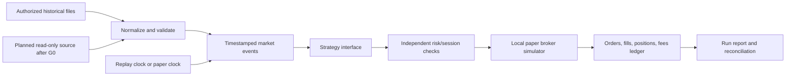

# Nifty Futures and Options Paper System — Build Roadmap

- **Status:** Current implementation is the integrated offline Java 21 `Intra-Paper-System/` in this repository. G0 remains open. Current evidence is recorded in [the 2026-11-14 checkout reconciliation](../../Intra-Paper-System/docs/OFFLINE-COMPLETION-2026-11-14.md).
- **Reviewed:** Checkout reconciled 2026-11-14 (Asia/Kolkata); external source/rule review remains open.
- **Final system design:** [NIFTY-INTRADAY-PAPER-SYSTEM-DESIGN.md](NIFTY-INTRADAY-PAPER-SYSTEM-DESIGN.md) defines the platform architecture and all ten strategy/execution-system designs.
- **Candidate read-only source:** Angel One SmartAPI, subject to G0 permissions, retention, route eligibility and operating review. No connection is enabled.
- **User-selected instruments:** Nifty index futures and Nifty index options.
- **Target:** A local, cost-aware backtest and paper simulator within the project's 90-day target. Strategy validation depends on data gates and is a separate outcome.

## 1. Existing baseline

This repository contains the research documents and the existing `Intra-Paper-System/` implementation. Continue that system for research, replay, and paper simulation. Historical lab notes are specifications and evidence context, not another product to build or permission to connect. Private inputs, credentials and run artifacts stay outside Git.

Historical Wave A notes describe S01–S03 index-signal definitions and a partial 2026-11-02 smoke session, including a then-pending completed-session refresh and a 2026-10-30 closing-period gap. Those runs were not reverified in this checkout review. Index markouts remain separate from dated-contract executable P&L. See the [Wave A plan](SAME-DAY-MVP-BUILD-PLAN.md), [signal specification](WAVE-A-SIGNAL-SPEC.md), and [instrument/data matrix](INSTRUMENT-DATA-CAPABILITY-MATRIX.md).

**System boundary:** one integrated `Intra-Paper-System/`. Deterministic local replay, risk, fills, accounting and reporting are implemented; future read-only paper ingestion must feed these components. The connected paper clock/adapter is not implemented and remains G0-dependent. The simulated broker remains local and separate from any future data adapter.

**Historical record, not current verification (2026-11-02):** earlier notes cited Python commits `c568543`, `3cde788`, `e86a465`, `5ef40d9`, `f3e8d27`, `f9f32f9`, and `ecd6fbc`, 18 tests, a daily-master import of 1,706 NIFTY rows, and read-only authentication/quote smoke checks. Those claims concern another recorded revision/environment and were not reproduced here. They do not establish a Java adapter, present account authorization, historical contract coverage, or data rights. No account access or capture occurred in this implementation session.

Current checkout: strict local bars/quotes, dated instruments and explicit session/rule calendars, local next-open/L1 IOC execution, risk controls, itemized dated costs, supplied settlement inputs, reconciliation, manifests, deterministic replay and offline operational evidence tools. Exact SPAN/ELM, daily variation margin, physical delivery, passive queue calibration, production paper-clock integration, authorized history and reviewed all-in costs remain open. Settlement requires explicit supported dated inputs; this implementation does not invent final-bar settlement proxies or forced liquidation prices.

## 2. Scope and operating modes

The design has two modes; historical replay is available, while connected paper mode is planned after G0. Both must use the same strategy, dated instruments, risk, fee model and local simulator:

1. **Historical replay:** read a frozen, locally staged dataset and advance a deterministic event clock. Each run records its code version, rule/config version, dataset and instrument-master hashes, cost-model version, and run ID.
2. **Planned live-data paper mode, disabled pending G0:** a reviewed read-only source supplies timestamped observations and completed bars to the existing core. Connection type, quote-to-bar completeness, clock policy and recovery require implementation and validation. No order API or fallback is permitted.

The market-data adapter and the simulated broker must be separate modules. Keep credentials in the user's local secret store and outside Git, logs, test fixtures, and run manifests. The paper runtime may connect to market-data endpoints only. Do not include or call SmartAPI place, modify, or cancel order endpoints. The system should stop creating new simulated entries when data are stale, disconnected, malformed, outside the configured session, or mapped to an unknown contract.

## 3. Instrument sequencing and data gates

Both futures and options are in scope. Build futures first because options require more contract, chain, expiry, and quote handling. Keep both goals explicit; passing the futures data gate does not imply the options gate has passed.

| Instrument | First use | Data gate | Known limitation |
|---|---|---|---|
| NIFTY 50 index | Signal research and benchmark only | Resolve timestamp semantics, full-session coverage, and the reproduced 30 Oct closing gap | Index volume is zero; index marks cannot be scored as executable futures/options P&L |
| Dated Nifty futures | First executable-contract backtest and paper simulator | Obtain dated contract prices, dated instrument metadata, and a defensible fill/cost model | The current capability matrix reports that SmartAPI does not provide expired F&O history; confirm with Angel One. Current-contract data alone cannot support a multi-expiry historical result |
| Nifty options | Contract-level premium backtest and paper simulator after futures plumbing | Obtain dated contract OHLC/quotes for selected strikes and expiries, plus expiry-aware contract metadata and settlement rules | SmartAPI's expired-contract history is reported unavailable, and historical Greeks/surface coverage is unverified. A backtest based only on current contracts is survivorship/selection biased |

For derivatives, preserve every actual contract and expiry. Never treat NIFTY index bars or a continuous futures chart as a fillable contract. Store dated instrument-master snapshots, including token, trading symbol, expiry, strike, option type, lot size, and tick size. Record the source terms, collection time, timezone, raw-file hash, and any corrections.

Before a multi-expiry backtest, select one of these lawful data paths: an archive whose license permits the intended local use, or prospective capture that spans the needed futures/options expiries. No-cost SmartAPI endpoints do not remove data-retention, history-depth, or completeness limits. If only prospective capture is available, report that the historical validation sample is not yet available; do not fill old expiries with current contracts or synthetic data.

## 4. Proposed system architecture

Start as one local process with a command-line interface and saved reports. The core modules should cover:

- **Market data:** CSV/Parquet import, SmartAPI read-only history/stream adapter, dated instrument master, exchange calendar, and provenance/data-quality checks.
- **Event engine:** deterministic replay and live paper clocks; normalize completed bars, quote snapshots, and disconnect/stale-data events.
- **Strategy interface:** strategy code receives only timestamped information available at that moment and returns an order intent or a no-trade reason.
- **Risk controls:** independent limits for quantity, notional, exposure, daily loss, order rate, allowed contracts, expiry, session cutoff, and stale data.
- **Paper broker:** local order states, simulated acknowledgements, fills, cancellations, rejections, cash, positions, fees, and end-of-session reconciliation. Generate local IDs; never reuse broker order IDs.
- **Run record:** immutable config, input and code hashes, signal/order/fill ledger, data warnings, and a summary report.

### Fill model

- A signal using a completed bar is known at that bar's close; the earliest bar-only simulated fill is the next eligible bar. Never fill at the close that generated the signal.
- With quote data, price marketable simulated orders against the available opposing quote and include configured latency/slippage. Record the quote age and local receive time.
- Do not assume a limit order fills because a candle touched its limit or because a five-level snapshot displayed size. Queue position and historical order events are not available from SmartAPI's documented snapshot feed.
- Use conservative, versioned assumptions for partial fills, rejection, expiry, spread, and slippage. Show results under sensitivity cases rather than hiding assumptions in strategy code.
- Maintain separate futures and options accounting. Options must track long/short premium, effective-dated lot size, expiry, and verified settlement/exit handling. Do not mark options solely from an underlying index value.

### Costs and reports

Use a dated, configurable cost model for brokerage and applicable exchange, statutory, tax, and stamp charges. Keep all cost components visible. Each report should show gross/net P&L, drawdown, exposure, turnover, realized/unrealized P&L, fees, fill/reject/partial-fill counts, holding time, and sensitivity to cost and fill assumptions. For options, also report results by expiry and option type; do not use aggregate results to hide a failing contract subset.

## 5. 90-day sequence

| Period | Work | Gate to continue |
|---|---|---|
| Weeks 1–2 | Qualify timestamps, complete sessions, source permissions and dated instruments; freeze the research card and private risk limits. | G0/G1 remain open until their required evidence exists. |
| Weeks 3–4 | Strengthen the existing Java local replay, provenance, input validation and automated tests. | Current results come from the checkout reconciliation, not historical Python test counts. |
| Weeks 5–6 | Reconcile futures/options accounting, fills, dated costs, risk and session controls. | Authorized dated data and reviewed schedules still gate economic interpretation. |
| Weeks 7–8 | Validate explicit contract settlement, option premium accounting and supplied margin inputs. | No invented settlement, exchange-margin or maintenance-liquidation assumptions. |
| Weeks 9–10 | After G0, implement read-only ingestion and a paper clock feeding the same core, with disconnect/stale-data and restart handling. | No connected adapter or qualifying forward session is currently verified. |
| Weeks 11–13 | Begin qualified forward paper sessions and daily reconciliation; continue beyond the illustrative schedule as needed. | G4 requires 60 complete sessions, 20 consecutive passing pre-open checks, drills, reconciliations and no unresolved severe incidents. |

The 90-day target is an operational paper/backtest system, not a promise of a profitable strategy or adequate multi-expiry validation. If expired-contract data cannot be secured, the system can be operational while the corresponding historical-performance gate remains closed.

## 6. First-release completion checks

- Futures and options are represented as dated, independently identifiable contracts; metadata is never guessed from a current token.
- Replay and future paper mode must use the existing simulator and accounting components in this system.
- Every signal, risk decision, simulated order transition, fill, fee, and position change has a timestamped explanation in the run ledger.
- Data gaps, stale quotes, unknown contract mappings, and incomplete sessions are explicit and prevent unsafe simulated entries or invalid scoring.
- A run can be reproduced from saved configuration, code/rule version, data hashes, instrument master, and cost/fill-model versions.
- Paper mode has no broker order-placement path and cannot fall back to live trading on errors.
- Derivative P&L is not reported from index markouts or a synthetic/continuous instrument where dated contract data are missing.

## 7. Regulatory and data-use checks

The SEBI retail algo framework and exchange implementation standards have an April 1, 2026 applicability date for brokers. NSE's standards describe static-IP mapping for API trading, broker risk checks, and audit requirements. This system's first release is paper-only and does not place orders. Recheck the current rules and Angel One's account/app requirements before adding any order route; a live-trading project would be a separate scope.

Market-data terms are a separate gate. The NSE policy covers use, storage, sharing, and redistribution. Confirm the source terms for local storage and replay, keep raw data private, and do not scrape exchange pages or redistribute data.

## 8. Decisions recorded and next actions

**Recorded:** Nifty dated futures first, then dated options, within this existing integrated system; no live order routing. Angel One is a candidate data route subject to current G0 review.

**Next actions:**

1. Review the completed-session Wave A refresh and resolve or formally retain the 30 Oct closing-gap data gate.
2. Confirm Angel One's current expired-contract history and data-only API requirements for this account.
3. Choose an authorized derivative-history source or a prospective capture plan within the data budget.
4. Run a CLI-level replay on frozen, authorized dated inputs and compare complete run manifests and ledgers; resolve any integration issues before market-data connection.
5. Select an authorized dated futures/options data source and verify local storage terms; until then backtest performance remains blocked.
6. Replace approximate margin and example fees with reviewed, dated schedules before interpreting results; validate expiry behavior with authorized dated settlement rows and option contract data.

## Project references

- [Instrument/data capability matrix](INSTRUMENT-DATA-CAPABILITY-MATRIX.md)
- [Isolated testing plan](ISOLATED-TESTING-PLAN.md)
- [Wave A signal specification](WAVE-A-SIGNAL-SPEC.md)
- [Lab data and run schema](LAB-DATA-SCHEMA.md)
- [Same-day Wave A MVP plan](SAME-DAY-MVP-BUILD-PLAN.md)

## External sources

- [SEBI: safer participation of retail investors in algorithmic trading](https://www.sebi.gov.in/legal/circulars/feb-2025/safer-participation-of-retail-investors-in-algorithmic-trading_91614.html)
- [SEBI: revised implementation timeline, including April 1, 2026 applicability](https://www.sebi.gov.in/sebi_data/attachdocs/sep-2025/1759232056254.pdf)
- [NSE: implementation standards for safer retail algo participation](https://nsearchives.nseindia.com/content/circulars/INVG67858.pdf)
- [NSE Data Sharing and Usage Policy](https://www.nseindia.com/static/market-data/nse-data-policy)
- [Angel One SmartAPI market-data documentation](https://smartapi.angelone.in/docs/MarketData)
- [Angel One SmartAPI rate limits](https://smartapi.angelone.in/docs/RateLimit)
